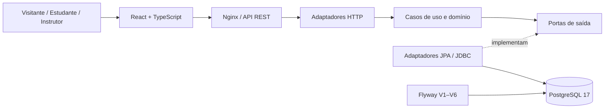

# CursoHub LMS

**Aprenda. Pratique. Evolua.** Uma plataforma de ensino online para transformar conhecimento em experiências práticas de aprendizagem.

[](backend/)
[](backend/)
[](frontend/)
[](frontend/)
[](backend/)
[](compose.yaml)

**CursoHub** é um projeto de **Learning Management System (LMS)** com catálogo de cursos, experiências separadas para estudantes e instrutores, aulas, matrículas, acompanhamento de progresso e gestão de conteúdos. A aplicação usa um **monólito modular**, princípios de **Clean Architecture** e **Arquitetura Hexagonal (Ports & Adapters)**.

> [!IMPORTANT]
> **Projeto em desenvolvimento — não é um serviço comercial em produção.**
> Este README documenta a versão da branch [`feature/social-links-course-sharing`](https://github.com/juceliocoelho2022/cursohub-lms./tree/feature/social-links-course-sharing), que reúne funcionalidades ainda em revisão. A branch `main` permanece estável, mas **não inclui necessariamente todos os recursos descritos aqui**. As integrações de pagamento, ativação de assinaturas e contas oficiais de redes sociais ainda não estão disponíveis.

## Navegação

- [Visão geral](#visão-geral)
- [Funcionalidades](#funcionalidades)
- [Tecnologias](#tecnologias)
- [Arquitetura](#arquitetura)
- [Executando o projeto](#executando-o-projeto)
- [Principais APIs](#principais-apis)
- [Planos e fidelidade](#planos-e-fidelidade)
- [Redes sociais e compartilhamento](#redes-sociais-e-compartilhamento)
- [Testes e qualidade](#testes-e-qualidade)
- [Segurança e limitações](#segurança-e-limitações)
- [Documentação e roadmap](#documentação-e-roadmap)

## Visão geral

O CursoHub reúne três frentes de uma plataforma educacional:

| Experiência | Recursos |
|---|---|
| **Visitante** | Home editorial de tecnologia, navegação por áreas, catálogo público, busca, filtros, informações dos cursos e planos apresentados de forma transparente. |
| **Estudante** | Cadastro, login, painel de matrículas, aulas de texto e vídeo, download de materiais, progresso, desbloqueio sequencial e pontos de fidelidade. |
| **Instrutor** | Estúdio de criação de cursos, módulos e aulas, publicação de rascunhos, capa personalizada, upload de materiais e videoaulas. |

O layout foi concebido para uma experiência responsiva, com seleção de aparência **Claro, Moderado e Black**. A linguagem editorial da home usa elementos visuais próprios do CursoHub, voltados à educação tecnológica.

## Funcionalidades

### Catálogo e identidade

- [x] Catálogo público de cursos publicados, com paginação, pesquisa, categoria e nível.
- [x] Cadastro público exclusivo para **estudantes**.
- [x] Login com JWT e segregação entre os perfis `STUDENT` e `INSTRUCTOR`.
- [x] Painel do estudante com cursos matriculados e informações de progresso.
- [x] Catálogo com capa, duração, categoria, nível e preço em reais.
- [x] Alternância entre os temas Claro, Moderado e Black.

### Ensino e produção de conteúdo

- [x] Estúdio do Instrutor: criar rascunho, adicionar módulo e aula e publicar curso.
- [x] Conteúdo de leitura, videoaulas MP4/WEBM e materiais PDF, imagem e ZIP.
- [x] Upload de capa JPG/PNG/WEBP para cursos novos e existentes.
- [x] Matrículas em cursos gratuitos, com controle de duplicidade.
- [x] Progresso das aulas obrigatórias e **desbloqueio sequencial**.
- [x] Conclusão da videoaula somente após reprodução registrada como **100%** pelo backend.
- [x] Arquivos de aulas disponíveis apenas aos usuários autorizados.

**Observação pedagógica:** o progresso de vídeo considera eventos de reprodução sujeitos a validações no servidor; isso não comprova atenção ou aprendizagem efetiva do aluno.

### Experiência comercial e comunidade

- [x] Apresentação de preços no catálogo; cursos gratuitos identificados.
- [x] Vitrine de planos Mensal, Semestral e Anual na home.
- [x] **Fidelidade gratuita**: 100 pontos por curso concluído; níveis Bronze, Prata e Ouro.
- [x] Área de redes sociais configurável e compartilhamento de links de cursos.
- [ ] Checkout, confirmação de pagamento e ativação real das assinaturas.
- [ ] Resgate de pontos ou aplicação financeira de descontos.
- [ ] Configuração dos perfis oficiais de todas as redes sociais.

> [!NOTE]
> **Avaliações e certificados** possuem implementação experimental no [PR #7](https://github.com/juceliocoelho2022/cursohub-lms./pull/7), **separada desta branch**. Não são anunciados aqui como funcionalidades disponíveis na versão atual. A política de certificação deverá ser validada antes da integração.

## Tecnologias

| Camada | Stack |
|---|---|
| Backend | Java 21, Spring Boot 4.1.2, Spring Security, Spring Data JPA |
| Arquitetura | Clean Architecture, Ports & Adapters, monólito modular |
| Autenticação | JWT HS256, BCrypt |
| Banco de dados | PostgreSQL 17, Flyway |
| Frontend | React 19, TypeScript 5, Vite 7 |
| Apresentação | CSS responsivo, Nginx |
| Conteúdo | Upload multipart e armazenamento MVP em PostgreSQL (`BYTEA`) |
| Infraestrutura local | Docker Compose |
| Qualidade | JUnit, Maven, checagem arquitetural, GitHub Actions |

## Arquitetura

O backend é dividido por contexto funcional: `catalog`, `identity`, `enrollment`, `student`, `learning`, `instructor`, `assets`, `cover`, `loyalty` e `membership`.



Os serviços de aplicação dependem de **portas**, não diretamente de detalhes de banco ou HTTP. Controllers, repositórios e infraestrutura atuam como adaptadores. As migrações Flyway versionam a estrutura relacional sem depender de `hibernate.hbm2ddl.auto=create`.

### Estrutura resumida

```text
cursohub-lms/
├── backend/
│   ├── src/main/java/br/com/cursohub/
│   │   ├── catalog/        # Consulta de cursos
│   │   ├── identity/       # Contas, autenticação e perfis
│   │   ├── instructor/     # Cursos, módulos e aulas
│   │   ├── enrollment/     # Matrículas
│   │   ├── student/        # Dashboard
│   │   ├── learning/       # Leitura, progresso e vídeos
│   │   ├── assets/         # Materiais do curso
│   │   ├── cover/          # Capas dos cursos
│   │   ├── loyalty/       # Pontos de aprendizagem
│   │   ├── membership/    # Catálogo de planos
│   │   └── shared/        # Recursos compartilhados
│   ├── src/main/resources/db/
│   │   ├── migration/      # Migrações Flyway
│   │   └── demo/           # Cursos demonstrativos locais
│   └── src/test/
├── frontend/
│   ├── public/social-links.json
│   ├── src/components/
│   ├── src/services/
│   └── nginx/default.conf
├── docs/
├── scripts/check_architecture.py
├── .github/workflows/
├── .env.example
└── compose.yaml
```

## Executando o projeto

### Pré-requisitos

- **Docker Desktop** com Docker Compose;
- **Git** e terminal **PowerShell** (nos exemplos abaixo);
- Portas `3000` (frontend) e `8080` (API) disponíveis.

> [!CAUTION]
> Se você já usa o CursoHub em `C:\Projetos\cursohub-lms-repo`, **preserve o arquivo `.env` e o volume do banco**. Não execute `docker compose down -v`: esse comando remove os dados do PostgreSQL. Use sempre `-p cursohub-lms` para manter o mesmo projeto Compose entre as branches.

### 1. Obter a versão documentada

A partir do seu clone local:

```powershell
cd C:\Projetos\cursohub-lms-repo
git status
git fetch origin
git switch --track origin/feature/social-links-course-sharing
```

Se a branch já existir localmente:

```powershell
git switch feature/social-links-course-sharing
git pull --ff-only origin feature/social-links-course-sharing
```

Verifique o `git status` antes de trocar de branch. Não descarte modificações locais sem analisá-las.

### 2. Configurar o ambiente

**Somente na primeira instalação**, crie um arquivo `.env` a partir do modelo:

```powershell
if (-not (Test-Path .env)) {
    Copy-Item .env.example .env
}
```

Edite o arquivo `.env` e configure uma senha local forte em `POSTGRES_PASSWORD`. Gere uma chave JWT com **32 bytes aleatórios**:

```powershell
[Convert]::ToBase64String(
    [Security.Cryptography.RandomNumberGenerator]::GetBytes(32)
)
```

Copie a saída gerada para o valor de `JWT_SECRET_BASE64` no `.env`.

**Não compartilhe nem versione `.env`, senhas ou segredos.** Se o banco já tiver dados, mantenha a senha de acesso existente; alterar a variável isoladamente não redefine a senha interna do PostgreSQL.

### 3. Iniciar os serviços

```powershell
docker compose -p cursohub-lms up -d --build
docker compose -p cursohub-lms ps

curl.exe -i http://localhost:8080/actuator/health
curl.exe -i http://localhost:8080/api/v1/courses
curl.exe -i http://localhost:8080/api/v1/membership/plans
```

| Serviço | Acesso local |
|---|---|
| Home e plataforma | [localhost:3000](http://localhost:3000) |
| API REST | [localhost:8080](http://localhost:8080) |
| Catálogo de cursos | [GET /api/v1/courses](http://localhost:8080/api/v1/courses) |
| Planos informativos | [GET /api/v1/membership/plans](http://localhost:8080/api/v1/membership/plans) |
| Healthcheck | [GET /actuator/health](http://localhost:8080/actuator/health) |
| PostgreSQL | `db:5432` **somente na rede interna Docker** |

O Nginx entrega o frontend na porta `3000` e encaminha as requisições `/api/` à API. As migrações Flyway são aplicadas ao inicializar o backend. A configuração Compose atual habilita dados demonstrativos; **não reutilize essa configuração de demonstração diretamente em produção**.

### Diagnóstico rápido

```powershell
docker compose -p cursohub-lms logs --tail=120 backend

docker compose -p cursohub-lms exec -T db psql -U cursohub -d cursohub -c "SELECT version,description,success FROM flyway_schema_history ORDER BY installed_rank;"
```

Nesta branch são esperadas as versões **V1, V2 (demo), V3, V4, V5 e V6**, todas com `success=t`.

### Desenvolvimento sem reconstruir o frontend a cada alteração

Pré-requisitos adicionais: Java 21, Maven e Node.js 22. Consulte a configuração de banco em [`compose.local-db-port.yaml`](compose.local-db-port.yaml). O Vite inicia na porta `5173` e encaminha `/api` à API local.

```powershell
cd frontend
npm install
npm run dev
```

## Principais APIs

| Método | Rota | Acesso |
|---|---|---|
| `GET` | `/api/v1/courses` | Público — catálogo, busca e filtros |
| `GET` | `/api/v1/courses/{slug}` | Público — detalhes do curso |
| `POST` | `/api/v1/auth/register` | Público — cadastro de estudante |
| `POST` | `/api/v1/auth/login` | Público — autenticação |
| `GET` | `/api/v1/auth/me` | JWT |
| `GET` | `/api/v1/students/me/dashboard` | Estudante |
| `POST` | `/api/v1/courses/{slug}/enrollments` | Estudante — curso gratuito |
| `GET` | `/api/v1/students/me/courses/{slug}/lessons` | Estudante matriculado |
| `POST` | `/api/v1/students/me/courses/{slug}/lessons/{lessonId}/video-progress` | Estudante matriculado |
| `GET` | `/api/v1/instructor/courses` | Instrutor |
| `POST` | `/api/v1/instructor/courses` | Instrutor — rascunho |
| `POST` | `/api/v1/instructor/courses/{courseId}/cover` | Instrutor dono — imagem |
| `POST` | `/api/v1/instructor/courses/{courseId}/assets` | Instrutor dono — materiais/vídeos |
| `GET` | `/api/v1/students/me/loyalty` | Estudante — pontos e nível |
| `GET` | `/api/v1/membership/plans` | Público — planos informativos |

Para o catálogo, os filtros incluem `q`, `categoria`, `nivel`, `page` e `size`. Endpoints de escrita exigem autenticação e autorização conforme o recurso.

## Planos e fidelidade

O **Clube CursoHub** apresenta condições comerciais propostas para contratação futura:

| Plano | Período | Valor total | Equivalente mensal | Acesso proposto |
|---|---:|---:|---:|---|
| Mensal | 1 mês | **R$ 59,90** | R$ 59,90 | Até 3 cursos elegíveis |
| Semestral | 6 meses | **R$ 269,40** | R$ 44,90 | Até 8 cursos elegíveis |
| Anual | 12 meses | **R$ 478,80** | R$ 39,90 | Todos os elegíveis |

**Não há vendas, cobrança recorrente, checkout, aprovação de pagamento ou liberação de assinatura nesta versão.** Os botões mostram `Contratação em breve`. Matrículas gratuitas em cursos com preço positivo são bloqueadas no backend para evitar acesso pago indevido.

O programa de fidelidade **gratuito** contabiliza **100 pontos por curso concluído** e classifica os estudantes em **Bronze** (0–1), **Prata** (2–4) e **Ouro** (5 ou mais). Pontos ainda **não podem ser trocados por descontos, dinheiro ou benefícios comerciais**.

Detalhes: [Preços, planos e fidelidade](docs/ETAPA10_PRECOS_PLANOS_FIDELIDADE.md).

## Redes sociais e compartilhamento

A área **Comunidade & Conexões** foi preparada para YouTube, Instagram, LinkedIn, GitHub, Facebook, TikTok e WhatsApp profissional. **Os perfis oficiais serão criados/configurados depois**; os campos vazios aparecem como `Em breve`.

Os endereços ficam em [`frontend/public/social-links.json`](frontend/public/social-links.json). Por enquanto, apenas o GitHub está configurado.

É possível copiar links da home e de cursos. Compartilhamento público por WhatsApp/LinkedIn exige que o CursoHub esteja hospedado em um **domínio HTTPS real**; `localhost` não é acessível para outras pessoas. Não são necessários tokens de redes sociais.

Leia o [guia de redes sociais e compartilhamento](docs/REDES_SOCIAIS_COMPARTILHAMENTO.md).

## Testes e qualidade

A automação do GitHub Actions executa testes Java com Maven, verificação das fronteiras arquiteturais, compilação React/TypeScript e testes de integração com PostgreSQL e JWT.

```powershell
# Na raiz do projeto
python scripts/check_architecture.py

cd backend
mvn verify

cd ../frontend
npm install
npm run build
```

**Workflows:** [CI Java/React](.github/workflows/ci.yml) · [Integração com PostgreSQL/JWT](.github/workflows/auth-integration.yml).

> Testes automatizados aprovados são evidência da implementação, **não uma certificação de prontidão para produção**. Também é necessária homologação visual e funcional em ambiente real.

## Segurança e limitações

- Cadastro público exclusivo para alunos; o perfil `INSTRUCTOR` não é selecionável no formulário público.
- Senhas armazenadas com **BCrypt**; autenticação via JWT assinado, com duração curta (15 minutos).
- A identidade de usuário é obtida do token validado, e não de IDs enviados pelo navegador.
- O frontend mantém o token de acesso em memória, não em `localStorage`.
- Materiais e vídeos exigem permissão e matrícula compatíveis; o download não recebe JWT na URL.
- Uploads têm limites e verificações de tipo. O armazenamento `BYTEA` no PostgreSQL é **adequado ao MVP**, não à operação em escala.
- A porta do PostgreSQL não fica exposta no Compose padrão.
- **Antes de produção:** configurar HTTPS/domínio, backup e restauração, observabilidade, gestão de segredos, limites de uso, recuperação de senha, verificação de e-mail, política de privacidade/LGPD, proteção de mídia e um provedor de pagamento com confirmação confiável.

## Documentação e roadmap

| Documento | Conteúdo |
|---|---|
| [Arquitetura técnica](docs/ARQUITETURA_TECNICA.md) | Componentes, dependências e implantação |
| [Modelo relacional](docs/MODELO_RELACIONAL.md) | DER, dicionário e regras de persistência |
| [Regras de negócio](docs/REGRAS_DE_NEGOCIO.md) | Entidades e restrições funcionais |
| [Autenticação](docs/ETAPA2_AUTENTICACAO.md) | Cadastro, login e JWT |
| [Painel do estudante](docs/ETAPA3_DASHBOARD_ALUNO.md) | Matrículas e indicadores |
| [Aulas e progresso](docs/ETAPA5_AULAS_E_PROGRESSO.md) | Acompanhamento de aprendizagem |
| [Estúdio do Instrutor](docs/ETAPA6_AREA_INSTRUTOR.md) | Autoria e publicação |
| [Materiais e vídeos](docs/ETAPA7_ANEXOS_VIDEO_SEQUENCIAL.md) | Uploads, reprodução e bloqueio |
| [Capas dos cursos](docs/ETAPA9_CAPA_DO_CURSO.md) | Imagens e regras de acesso |
| [Home editorial](docs/HOME_EDITORIAL_TECH_FIAP_INSPIRED.md) | Design e homologação |
| [Roadmap](docs/ROADMAP.md) | Evolução planejada do produto |

**Próximos marcos:** integrar e homologar os PRs de funcionalidades, finalizar avaliações/certificados, implementar checkout seguro, ativação e expiração de assinaturas, melhorias de acessibilidade e publicação em domínio próprio.

### Estado das branches

O desenvolvimento está organizado em **pull requests de rascunho**, ainda não mesclados na `main`:

- [#7 — Avaliações e certificados](https://github.com/juceliocoelho2022/cursohub-lms./pull/7) — desenvolvimento independente.
- [#8 — Capa dos cursos](https://github.com/juceliocoelho2022/cursohub-lms./pull/8).
- [#9 — Preços, planos e fidelidade](https://github.com/juceliocoelho2022/cursohub-lms./pull/9).
- [#10 — Home premium](https://github.com/juceliocoelho2022/cursohub-lms./pull/10).
- [#11 — Home editorial tech](https://github.com/juceliocoelho2022/cursohub-lms./pull/11).
- [#12 — Redes sociais e compartilhamento](https://github.com/juceliocoelho2022/cursohub-lms./pull/12).

Os PRs **#8 → #9 → #10 → #11 → #12** são dependentes em sequência; a integração deverá respeitar essas dependências. O PR #7 segue separado.

---

**Idealização e desenvolvimento:** [Professor Jucelio Coelho](https://github.com/juceliocoelho2022)  
**Projeto:** [CursoHub LMS](https://github.com/juceliocoelho2022/cursohub-lms.) · Educação, tecnologia e aprendizagem contínua.
