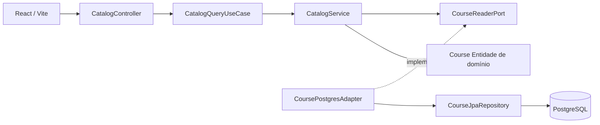

# CursoHub LMS — Clean Architecture + Arquitetura Hexagonal

## Decisão arquitetural (Etapa 1)

Adotamos um **monólito modular**, organizado por domínio de negócio (`catalog`). Combinamos Clean Architecture (dependências de código voltadas para o núcleo) com Arquitetura Hexagonal (portas e adaptadores). O frontend React é um cliente HTTP externo e não pertence ao domínio Java.

### Diagrama de componentes



**Fluxo em execução:** HTTP → porta de entrada → caso de uso → porta de saída → adaptador → JPA → Postgres.

**Dependências de código:** adaptadores e configuração dependem das portas do núcleo. O núcleo não importa classes de infraestrutura. A seta do serviço para a porta de saída aponta para uma interface definida no núcleo, que o adaptador implementa.

## Estrutura de pacotes

```text
br.com.cursohub/
├── CursoHubApplication.java
├── catalog/
│   ├── domain/
│   │   ├── Course.java
│   │   ├── CourseLevel.java
│   │   └── CourseStatus.java
│   ├── application/
│   │   ├── CatalogService.java
│   │   ├── exception/
│   │   ├── model/
│   │   └── port/
│   │       ├── in/CatalogQueryUseCase.java
│   │       └── out/CourseReaderPort.java
│   ├── adapters/
│   │   ├── in/web/
│   │   └── out/persistence/
│   └── config/CatalogConfiguration.java
└── shared/api/ApiErrorHandler.java
```

## Exemplo: buscar curso por slug

1. GET `/api/v1/courses/java-backend-do-zero` chega ao `CatalogController`.
2. Controller chama a porta `CatalogQueryUseCase.findPublishedBySlug(slug)`.
3. `CatalogService` coordena o caso de uso e exige que `Course.isPublished()` seja verdadeiro.
4. O serviço chama `CourseReaderPort`, sem dependência de JPA.
5. `CoursePostgresAdapter` implementa a porta, consulta `CourseJpaRepository` e traduz `JpaCourseEntity` para `Course`.
6. O controller cria `CourseResponse` e devolve JSON.
7. Ausência ou indisponibilidade gera `CourseNotFoundException`, convertida pelo adaptador HTTP em 404.

## Por que não usar @Entity no domínio?

`Course` é Java puro e mantém regras de negócio. `JpaCourseEntity` mapeia a tabela `courses`. O adaptador traduz entre os formatos. Assim, testes de aplicação podem substituir a persistência por um `CourseReaderPort` falso.

## Próximos módulos

- `identity`: autenticação e autorização;
- `catalog`: consulta e gestão de cursos;
- `enrollment`: matrículas;
- `learning`: módulos, aulas e progresso;
- `assessment`: avaliações e tentativas;
- `certificate`: certificação.

Nem toda classe precisa ter uma interface; portas devem representar fronteiras reais.

## Persistência e qualidade

- PostgreSQL 17; Flyway em `db/migration`, dados locais opcionais em `db/demo`.
- JPA restrito a adaptadores; `ddl-auto=validate`.
- Nginx faz proxy de `/api/`; Vite fornece proxy no desenvolvimento.
- API `/api/v1`, somente leitura pública na Etapa 1.
- O domínio/aplicação **não importam** Spring, JPA, adaptadores, controllers ou banco.
- Casos de uso aceitam interfaces pelo construtor; códigos HTTP pertencem ao adaptador.
- Testes isolados verificam regras sem Spring e banco.

Verificação: `python scripts/check_architecture.py`.

## Segurança e limites

A Etapa 1 é apenas um catálogo público. Não há login, matrícula, upload de aulas, pagamento ou certificados funcionais. Antes de produção, incorporar autenticação, controle de acesso, proteção de mídia, gestão de segredos, LGPD, observabilidade, backups e testes de integração.
