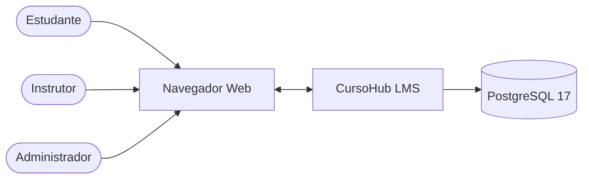
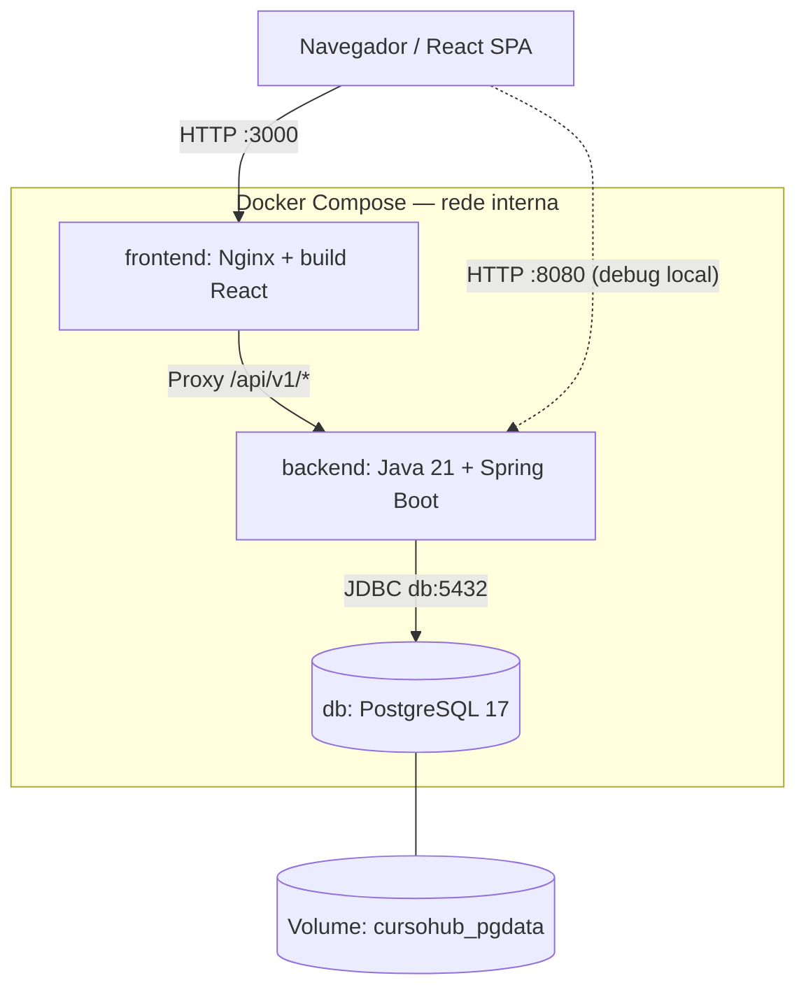
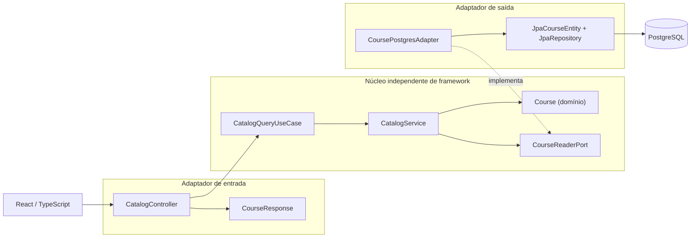
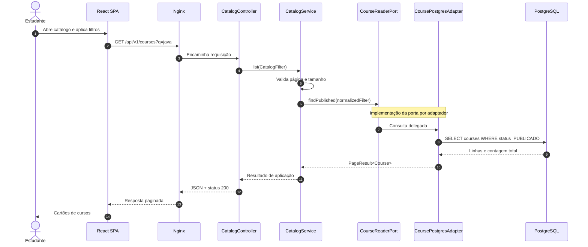
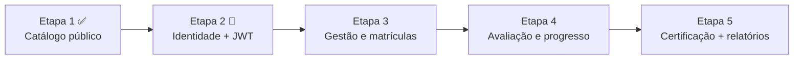

# CursoHub LMS — Arquitetura Técnica

**Baseline:** branch `main` da Etapa 1 · **Estilo:** monólito modular + Clean Architecture + Ports & Adapters · **Ambiente:** Docker Compose para desenvolvimento.

Esta documentação descreve a arquitetura **implementada**, distingue módulos **planejados** e registra decisões e riscos técnicos. Os diagramas são Mermaid, renderizados diretamente pelo GitHub.

## 1. Contexto da solução



**Implementado na `main`:** catálogo público consultado pelo navegador. As experiências de instrutor e administrador, matrícula e certificação são **planejadas**.

## 2. Containers / deployment — Etapa 1



| Componente | Porta pública no host | Protocolo | Responsabilidade |
|---|---:|---|---|
| SPA React via Nginx | 3000 | HTTP | Entrega o frontend e encaminha `/api` |
| Spring Boot API | 8080 em `127.0.0.1` | HTTP/JSON | Casos de uso e consultas de catálogo |
| PostgreSQL | **Não publicada** por padrão | JDBC/TCP 5432 interno | Persistência e constraints |
| PostgreSQL via override opcional | 5433 em `127.0.0.1` | TCP | Apenas depuração/cliente local |

**Distinção importante:** `db:5432` é endereço resolvido **entre containers**. Um Spring Boot rodando fora do Docker precisa usar um banco publicado no host, como o override em `localhost:5433`, com credenciais adequadas.

## 3. Diagrama de componentes — Ports & Adapters



### Regra de dependência

- `catalog/domain`: regras do domínio em Java puro.
- `catalog/application`: caso de uso, contratos (`port.in` e `port.out`) e modelos de aplicação, sem Spring/JPA.
- `catalog/adapters/in/web`: controller e serialização JSON, depende da porta de entrada.
- `catalog/adapters/out/persistence`: JPA e consultas ao banco, implementa a porta de saída.
- `catalog/config`: composition root com beans Spring.
- `shared/api`: erros HTTP sem poluir o domínio.

**Validação automatizada:** `python scripts/check_architecture.py` rejeita imports técnicos no domínio e na aplicação. Testes de unidade usam porta falsa para substituir persistência.

## 4. Diagrama de sequência — GET /api/v1/courses



A sequência mostra um **fluxo lógico**. No Java a interface `CourseReaderPort` não é objeto intermediário separado: o `CatalogService` invoca uma implementação vinculada pelo Spring, `CoursePostgresAdapter`.

## 5. Modelo relacional e fonte de verdade

- [Diagrama ER completo, cardinalidades, chaves, índices e SQL](MODELO_RELACIONAL.md).
- [Flyway V1 — DDL implementado](../backend/src/main/resources/db/migration/V1__create_learning_platform.sql).
- [Regras de negócio e critérios de aceite](REGRAS_DE_NEGOCIO.md).

O esquema V1 contempla 12 tabelas: usuários, cursos, módulos, aulas, matrículas, progresso, avaliações, questões, alternativas, tentativas, respostas e certificados. A API da Etapa 1 lê os cursos publicados; as demais operações são trabalho futuro.

## 6. Contrato REST — Etapa 1

| Método | Caminho | Status de sucesso | Erros possíveis |
|---|---|---:|---|
| GET | `/api/v1/courses` | 200 | 400 |
| GET | `/api/v1/courses/{slug}` | 200 | 400, 404 |
| GET | `/actuator/health` | 200 quando saudável | 503 quando não saudável |

**Filtros do catálogo:** `q` (texto), `categoria`, `nivel`, `page` (base 0) e `size` (1 a 48).

### Exemplo de resposta de catálogo

```json
{
  "content": [
    {
      "id": "22222222-2222-4222-8222-222222222221",
      "slug": "java-backend-do-zero",
      "title": "Java Backend: do Zero às APIs",
      "description": "Aprenda Java 21, orientação a objetos e os fundamentos para criar APIs REST com Spring Boot.",
      "category": "Programação",
      "level": "INICIANTE",
      "estimatedMinutes": 720,
      "thumbnailUrl": null
    }
  ],
  "totalElements": 4,
  "page": 0,
  "size": 12,
  "totalPages": 1
}
```

**Nota:** os valores são ilustrativos a partir do seed de demonstração, e a resposta real depende dos filtros, páginas e registros existentes.

## 7. Persistência, migração e observabilidade

- Hibernate no modo `ddl-auto=validate`: o esquema pertence ao **Flyway**, não ao auto-DDL.
- `db/migration/V1__create_learning_platform.sql`: criação das tabelas e constraints.
- `db/demo/V2__demo_catalog.sql`: massa de testes apenas quando `FLYWAY_LOCATIONS` inclui o diretório `demo`.
- PostgreSQL é dependência essencial; Docker usa healthcheck `pg_isready`.
- Endpoint técnico `/actuator/health` para verificar estado da API.
- Branch `main`: pipeline GitHub Actions com testes Maven, verificação de arquitetura e build TypeScript/React.
- A interface React tem tratamento de carregamento, consulta vazia e erro de API.

## 8. Requisitos não funcionais

| Categoria | Diretriz |
|---|---|
| Segurança | Segredos apenas por variáveis de ambiente; nenhum `.env` no Git |
| Dados pessoais | Minimização de campos, acesso por perfil, futura conformidade com LGPD |
| Integridade | PK/FK/UNIQUE/CHECK no banco + invariantes em casos de uso |
| Confiabilidade | Migração versionada, testes em pipeline, healthcheck e backup antes de produção |
| Desempenho | Paginação e índices; medir com `EXPLAIN (ANALYZE, BUFFERS)` |
| Evolução | Contratos REST versionados em `/api/v1` e limites claros por domínio |
| Qualidade | Dependências voltadas para dentro; testes com falsos adaptadores; CI |
| Operação | Logs estruturados e métricas detalhadas são próximos incrementos |

## 9. ADR-001 — Monólito modular antes de microsserviços

**Decisão:** manter o backend como uma aplicação Spring Boot com módulos de domínio e limites definidos por portas.

**Motivos:** simplificar transações, evolução inicial, testes, deploy e custo de operação.

**Trade-off:** isolamento operacional entre contextos é limitado; será necessária disciplina na organização dos pacotes e das dependências. Se houver necessidade real de escalar módulos independentemente, a separação poderá ser revisitada com dados de uso e critérios de operação.

## 10. Roadmap da arquitetura



**Atenção:** a Etapa 2 está em desenvolvimento em branch separada; não é funcionalidade liberada na `main`.
