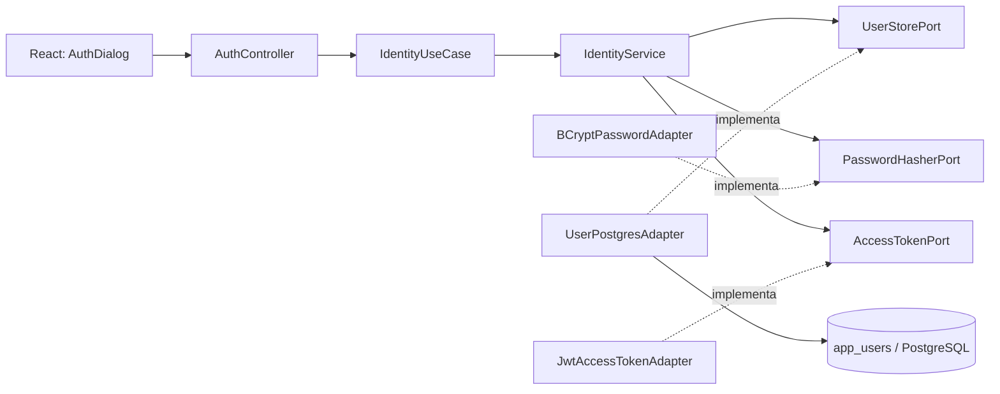

# CursoHub LMS — Etapa 2: Cadastro de Alunos e JWT

> Implementação proposta na branch `feature/identity-auth`. **Não mesclar na `main` antes de validar localmente.**

## Escopo

- Cadastro público de alunos (perfil **STUDENT** fixo no backend)
- Senhas com BCrypt (custo 12)
- Login com e-mail normalizado e senha
- JWT HS256 de curta duração (15 minutos)
- Identificação de usuário ativo pela rota autenticada `GET /api/v1/auth/me`
- Telas React de login e cadastro (token em memória)
- Testes de aplicação sem iniciar Spring ou PostgreSQL

**Não faz parte desta etapa:** cadastro de administradores/instrutores, recuperação de senha, verificação de e-mail, refresh token, logout com revogação no backend, rate limiting, proteção antiautomação e moderação de contas. Esses itens serão necessários antes de produção.

## Arquitetura Hexagonal



### Domínio

`UserAccount` e `UserRole` são Java puro, assim como `IdentityService`, comandos, DTOs internos e interfaces de portas. As tecnologias de infraestrutura ficam em `adapters` e `config`.

O schema `app_users` já existe desde `V1__create_learning_platform.sql`: **não foi necessário alterar migrações aplicadas**.

## Regras de negócio

1. Cadastro aberto somente para perfil `STUDENT`; ninguém pode escolher `ADMIN` ou `INSTRUCTOR` na requisição.
2. Nome de 3 a 150 caracteres e e-mail válido, normalizado em minúsculas.
3. Senha de no mínimo 12 caracteres, com até 72 bytes UTF-8 (restrição BCrypt).
4. E-mail único por `lower(email)` no banco, inclusive sob requisições concorrentes.
5. Hash BCrypt, nunca devolver ou registrar senha em texto claro.
6. Token de acesso assinado HS256, com `sub` igual ao UUID do usuário, `role`, emissor `cursohub-api` e expiração.
7. A rota `/auth/me` exige token assinado válido, usuário existente, ativo e perfil consistente.
8. O catálogo público deve permanecer acessível anonimamente.

## Preparar ambiente com segurança (PowerShell)

Na pasta **`C:\Projetos\cursohub-lms-repo`**, primeiro verifique se existem alterações locais:

```powershell
cd C:\Projetos\cursohub-lms-repo
git status
git fetch origin
git switch feature/identity-auth
git pull --ff-only origin feature/identity-auth
```

**Uma única vez**, garanta que a configuração real existe e tenha uma chave JWT exclusiva.

Se ainda não tem um `.env`, copie o exemplo (o exemplo contém senha **somente para ambiente local**):

```powershell
if (-not (Test-Path .env)) { Copy-Item .env.example .env }
```

Gere o segredo **uma única vez**, sem imprimi-lo no terminal:

```powershell
$envFile = Join-Path (Get-Location) '.env'
if (-not (Select-String -Path $envFile -Pattern '^JWT_SECRET_BASE64=.+$' -Quiet)) {
    $secret = [Convert]::ToBase64String([Security.Cryptography.RandomNumberGenerator]::GetBytes(32))
    $lines = Get-Content $envFile
    if ($lines -match '^JWT_SECRET_BASE64=') {
        $lines = $lines -replace '^JWT_SECRET_BASE64=.*$', "JWT_SECRET_BASE64=$secret"
        Set-Content -Path $envFile -Value $lines -Encoding utf8
    } else {
        Add-Content -Path $envFile -Value "JWT_SECRET_BASE64=$secret"
    }
    Remove-Variable secret
}
```

**Não compartilhe `.env` ou o valor de `JWT_SECRET_BASE64`.** Recriar o segredo invalida tokens já emitidos.

## Execução usando o volume PostgreSQL existente

O ambiente anterior já utiliza os containers do projeto Docker Compose `cursohub-lms`. **Não use `down -v`**.

```powershell
docker compose -p cursohub-lms config --quiet
docker compose -p cursohub-lms up -d --build
docker compose -p cursohub-lms ps
```

Endereços:

- React: http://localhost:3000
- Spring Boot: http://localhost:8080
- PostgreSQL: acessado internamente por `db:5432` (não publicado no host)

Se o backend não iniciar, confira os logs sem exibir segredos:

```powershell
docker compose -p cursohub-lms logs --tail 80 backend
```

## Verificar API de autenticação

Os exemplos abaixo usam **credenciais fictícias de teste**, não dados pessoais reais.

```powershell
$novoAluno = @{
    name     = "Aluno de Teste"
    email    = "aluno.teste@example.com"
    password = "SenhaForte#CursoHub2026"
} | ConvertTo-Json

$cadastro = Invoke-RestMethod -Method Post -Uri http://localhost:8080/api/v1/auth/register `
    -ContentType 'application/json' -Body $novoAluno

# Sem imprimir o JWT no console:
$token = $cadastro.accessToken
$cadastro | Select-Object name, email, role, expiresIn

$perfil = Invoke-RestMethod -Uri http://localhost:8080/api/v1/auth/me `
    -Headers @{Authorization = "Bearer $token"}
$perfil | Select-Object name, email, role

# Verificar que login também funciona:
$login = Invoke-RestMethod -Method Post -Uri http://localhost:8080/api/v1/auth/login `
    -ContentType 'application/json' `
    -Body (@{ email = "aluno.teste@example.com"; password = "SenhaForte#CursoHub2026" } | ConvertTo-Json)
$login | Select-Object name, role, expiresIn
```

Uma segunda tentativa de cadastrar o mesmo e-mail deve retornar HTTP **409 Conflict**. A rota `/api/v1/auth/me` sem token deve retornar **401 Unauthorized**.

## Rodar testes

```powershell
python scripts/check_architecture.py
cd backend
mvn clean verify
cd ../frontend
npm install
npm run build
```

## Desenvolvimento local no IntelliJ

A API Spring Boot executada pelo IntelliJ precisará receber `JWT_SECRET_BASE64` e as mesmas variáveis do PostgreSQL.

- Se rodar o frontend pelo Docker, ele usa o backend Docker em `8080`, independentemente de outra instância Java.
- Se usar backend externo ao Docker, publique o PostgreSQL de forma explícita pelo override `compose.local-db-port.yaml`, configurando o JDBC como `localhost:5433`, e rode Java na porta `8081` quando a 8080 estiver ocupada.
- Atenção: há outro projeto no seu Docker que já utilizou a porta 5433. Verifique a disponibilidade antes de optar por esse modo, em vez de iniciar outro container com porta concorrente.

## Critérios de aceite

- [ ] Build/CI Java e frontend sem erros
- [ ] Catálogo público permanece acessível
- [ ] Cadastro retorna 201, `role=STUDENT`, e-mail normalizado
- [ ] E-mail duplicado retorna 409
- [ ] Login correto retorna token de 15 minutos
- [ ] Login incorreto retorna 401
- [ ] `/auth/me` sem token retorna 401
- [ ] `/auth/me` com token válido retorna o perfil
- [ ] Token não aparece em URL, localStorage ou logs
- [ ] Registro persiste após reiniciar o backend
