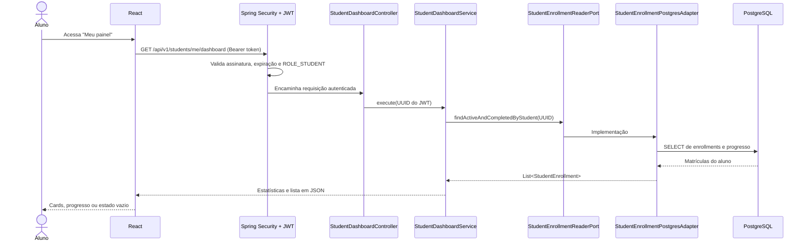

# CursoHub LMS — Dashboard do Aluno (primeira entrega)

**Branch:** `feature/student-dashboard` · **Status:** implementação e validação do PR; não disponível na `main` até aprovação e merge.

## O que foi implementado

- Tela **Meu painel** para usuários com papel `STUDENT`.
- Estatísticas calculadas a partir de matrículas existentes: total, em andamento e concluídas.
- Lista das matrículas `ACTIVE` e `COMPLETED`; matrículas `CANCELLED` não são exibidas no painel.
- Progresso das **aulas obrigatórias**, derivado de `lesson_progress` com verificação de que a aula pertence ao mesmo curso.
- Estado vazio para aluno sem matrícula; nenhuma matrícula ou porcentagem fictícia.
- Endpoint REST autenticado, sem parâmetro `studentId` fornecido pelo navegador.
- Testes unitários do núcleo e smoke tests reais com PostgreSQL no GitHub Actions.

## Fluxo técnico



## Modelo relacional consultado

`app_users (id)` — 1:N → `enrollments (student_id)` ← N:1 — `courses (id)`.

`courses` — 1:N → `course_modules` — 1:N → `lessons`. O vínculo entre `enrollments` e `lessons` é registrado na tabela `lesson_progress`.

A consulta usa **somente o UUID presente no JWT** para filtrar as matrículas, não IDs enviados na query string. As aulas contabilizadas no numerador também são verificadas como pertencentes ao curso da matrícula.

## Endpoint

**GET `/api/v1/students/me/dashboard`**

- **200:** usuário com JWT válido e papel STUDENT.
- **401:** sem token ou token inválido/expirado.
- **403:** conta autenticada sem perfil STUDENT.
- **500:** erro inesperado; deve ser investigado nos logs.

Resposta de aluno sem matrícula:

```json
{
  "enrolledCourses": 0,
  "inProgressCourses": 0,
  "completedCourses": 0,
  "courses": []
}
```

Com matrículas, `courses` contém `enrollmentId`, `courseId`, `slug`, `title`, `category`, `status`, `requiredLessons`, `completedLessons`, `progressPercent` e `enrolledAt`.

**Regra de progresso:** arredondamento para inteiro de `completedLessons * 100 / requiredLessons`. Quando o curso ainda não tem aulas obrigatórias, o valor é 0%, não 100%.

## Executar no Windows

Na pasta já clonada:

```powershell
cd C:\Projetos\cursohub-lms-repo

git status
git fetch origin
git switch --track origin/feature/student-dashboard

# Preserva o mesmo projeto Docker e volume de banco existentes.
docker compose -p cursohub-lms up -d --build
docker compose -p cursohub-lms ps
```

Se já existe a branch local, use `git switch feature/student-dashboard` seguido de `git pull --ff-only`.

**Importante:** o `.env` deve continuar contendo `JWT_SECRET_BASE64` e `POSTGRES_PASSWORD` configurados na Etapa 2. Não faça commit do `.env`. Não execute `docker compose down -v`.

No navegador, entre como aluno em http://localhost:3000 e use o botão **Meu painel**. Caso o estudante ainda não tenha matrículas, o painel exibirá as estatísticas zeradas e um convite para explorar cursos.

## Testes

```powershell
python scripts/check_architecture.py
cd backend
mvn clean verify
cd ..
curl.exe -i http://localhost:8080/actuator/health
```

Além dos testes unitários, a integração do GitHub Actions cria matrícula e progresso fictícios **apenas no banco temporário de CI** para verificar:

1. acesso sem token → 401;
2. aluno sem matrícula → lista vazia e totais 0;
3. aluno com matrícula e 1/2 aulas concluídas → 50%;
4. outro aluno não consegue visualizar a matrícula de terceiros.

## Limites e próximos passos

- **Matrícula self-service ainda não implementada**. Nenhuma ação de inscrever-se deve ser apresentada como funcional.
- Aulas e avaliação do aluno ainda dependem de casos de uso futuros.
- O dashboard faz leitura das matrículas existentes; a operação de concluir aulas virá na próxima etapa.
- Paginação do dashboard e caching são futuras melhorias de escala.
- Acesso autenticado depende de JWT em memória no React; recarregar a página requer novo login.
