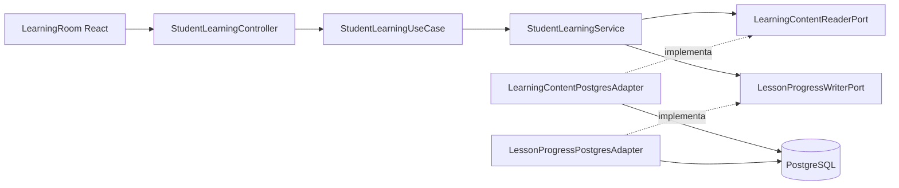
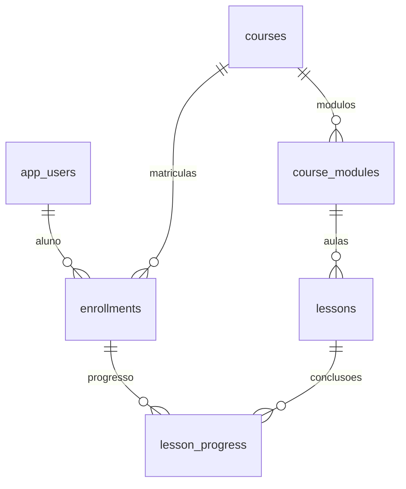

# CursoHub LMS — Etapa 5: Aulas e Progresso

**Status:** implementação proposta em `feature/learning-lessons`; aguarda validação no Docker antes do merge na `main`.

## Resultado para o aluno

1. Faça login em `http://localhost:3000`.
2. Em **Meu painel**, clique em **Acessar aulas** de um curso matriculado.
3. No ambiente de aprendizagem, navegue pelos módulos e aulas disponíveis.
4. Leia os textos ou abra os materiais de vídeo e PDF, quando cadastrados.
5. Clique em **Marcar aula como concluída** para persistir o avanço.
6. O indicador de progresso reflete as **aulas obrigatórias** concluídas e volta atualizado ao painel.

Os temas **Claro, Moderado e Black** continuam funcionando na área de aulas.

## Arquitetura Clean + Hexagonal



**Núcleo Java puro:** `learning/domain` e `learning/application` não importam Spring, SQL ou JPA. O adaptador acessa as tabelas já criadas pelo Flyway V1.

## Relacionamentos utilizados



## Contrato REST

| Método | Endpoint | Acesso |
|---|---|---|
| `GET` | `/api/v1/students/me/courses/{slug}/lessons` | Apenas STUDENT com matrícula ACTIVE/COMPLETED |
| `POST` | `/api/v1/students/me/courses/{slug}/lessons/{lessonId}/complete` | Apenas STUDENT com matrícula ACTIVE para nova conclusão |

**Consulta:** devolve curso, módulos e aulas ordenados, tipo (`TEXT`, `VIDEO`, `PDF`), conteúdo de texto/URL, indicador de conclusão, `requiredLessons`, `completedRequiredLessons` e `progressPercent`. Aula de outro curso ou matrícula de outro estudante não é exposta.

**Conclusão:** responde 200 com `{ "lessonId": "UUID", "newlyCompleted": true }`. Repetir a operação retorna `newlyCompleted: false` com o mesmo registro; uma conclusão já registrada pode ser consultada mesmo se a matrícula passou para `COMPLETED`.

- 401 sem token ou token expirado.
- 403 usuário autenticado sem papel STUDENT.
- 404 sem matrícula apropriada ou aula inexistente/não pertencente ao curso.
- 400 slug inválido/ID de aula malformado.

## Regras de negócio e limites

- O UUID do estudante vem **somente do JWT validado**. Não existe `studentId` informado pelo navegador.
- Uma aula só pode ser concluída por um aluno matriculado no curso correspondente.
- O banco garante `UNIQUE(enrollment_id,lesson_id)`, inclusive sob duas requisições simultâneas.
- O progresso obrigatório é `Math.round(concluídasObrigatórias * 100 / totalObrigatórias)`. Se não houver aulas obrigatórias, é **0%**, e não 100%.
- Aulas opcionais podem ser marcadas concluídas, mas não aumentam o percentual obrigatório.
- A conclusão é **manual**, não depende de o usuário assistir ao vídeo até o fim.
- **O status da matrícula não é alterado automaticamente para COMPLETED** nesta etapa. Futuramente precisaremos avaliar também avaliações obrigatórias antes de emitir certificado.
- Conteúdo PDF e vídeo é referenciado por **URL HTTPS**; o sistema **ainda não tem upload, streaming privado, hospedagem ou DRM**.
- Um link HTTPS para material externo **não é protegido pela matrícula depois de divulgado**. Para material privado de produção, integrar armazenamento seguro e URLs temporárias.
- A Etapa 5 não inclui editor para instrutor criar aulas no navegador. Usa conteúdos existentes no PostgreSQL, incluindo as aulas de texto demonstrativas.

## Executar localmente sem perder o banco

```powershell
cd C:\Projetos\cursohub-lms-repo
git status
git fetch origin
git switch --track origin/feature/learning-lessons
docker compose -p cursohub-lms up -d --build
docker compose -p cursohub-lms ps
```

Use `git switch feature/learning-lessons` e `git pull --ff-only` se a branch já estiver criada no computador. Preserve o arquivo `.env` atual e **não execute `docker compose down -v`**.

## Critérios de aceite

- [ ] Java/Maven, testes unitários, arquitetura e build React GREEN.
- [ ] Testes HTTP reais no PostgreSQL e JWT GREEN.
- [ ] Aluno sem matrícula não acessa curso privado.
- [ ] Aluno matriculado vê módulos e aulas do seu curso.
- [ ] Registro de conclusão muda o progresso no banco e no painel.
- [ ] Repetir a conclusão não duplica registro.
- [ ] Usuário sem login não acessa as aulas.
- [ ] Trocar entre Claro, Moderado e Black funciona na sala de aula.
