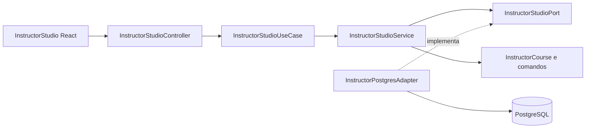
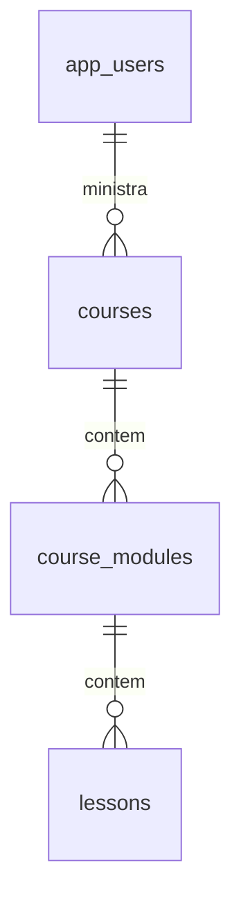

# CursoHub LMS — Etapa 6: Área do Instrutor

**Branch:** `feature/instructor-studio` · **Situação:** implementação em Pull Request, sem merge na `main` até a validação local.

## 1. Funcionalidade

- Painel **Estúdio do Instrutor** integrado à interface React.
- Listagem de cursos pertencentes ao instrutor autenticado.
- Criação de curso em **RASCUNHO**.
- Inclusão de módulos e aulas `TEXT`, `VIDEO` e `PDF`.
- Materiais externos referenciados por URLs HTTPS válidas (nenhum upload ainda).
- Publicação de curso com ao menos uma aula obrigatória.
- Conteúdo de curso publicado apresentado em modo somente leitura.
- Visualização nos temas **Claro, Moderado e Black**.
- Proteção por JWT, papel `ROLE_INSTRUCTOR` e conferência de `instructor_id` no PostgreSQL.

## 2. Modelo arquitetural



O núcleo da aplicação não contém imports do Spring. O adaptador de persistência implementa as operações no PostgreSQL em transações, bloqueando a linha do curso com `FOR UPDATE` nas inclusões de módulos e aulas para serializar a atribuição de posições.

A estrutura relacional existente da V1 é reutilizada:



## 3. Endpoints REST

Todas as rotas exigem JWT autenticado de usuário ativo com papel `INSTRUCTOR`.

| Método | Endpoint | Sucesso |
|---|---|---|
| GET | `/api/v1/instructor/courses` | 200, lista dos cursos próprios |
| GET | `/api/v1/instructor/courses/{id}/content` | 200, módulos e aulas do curso |
| POST | `/api/v1/instructor/courses` | 201, curso em rascunho |
| POST | `/api/v1/instructor/courses/{id}/modules` | 201, módulo criado |
| POST | `/api/v1/instructor/courses/{id}/modules/{moduleId}/lessons` | 201, aula criada |
| POST | `/api/v1/instructor/courses/{id}/publish` | 200, curso publicado |

Erros relevantes: `400` para conteúdo inválido, `401` para token ausente/inválido, `403` para conta sem papel de instrutor, `404` quando o curso não pertence ao usuário, `409` para slug duplicado, curso sem aula obrigatória ou tentativa de editar conteúdo já publicado.

## 4. Regras de negócio

1. **Somente instrutor:** o registro público ainda cria exclusivamente `STUDENT`. Não é permitido solicitar privilégios pelo formulário.
2. **Identidade segura:** `instructor_id` vem exclusivamente do `sub` do JWT, nunca de um campo informado pelo navegador.
3. **Propriedade dos cursos:** toda listagem, consulta e edição verifica `courses.instructor_id`.
4. **Rascunhos:** módulos e aulas só podem ser adicionados quando o status for `RASCUNHO`.
5. **Publicação:** requer ao menos uma aula obrigatória e muda `published_at`; repetição da publicação é idempotente.
6. **Ordem:** posições atribuídas automaticamente, com travamento transacional do curso.
7. **Validação de conteúdo:** aulas de texto exigem conteúdo não vazio; vídeo/PDF exigem URL com protocolo HTTPS, host válido, sem credenciais incorporadas ou fragmento.
8. **Limite da etapa:** ainda não existe edição, exclusão, upload de PDF, serviço de streaming, organização de preço ou convite automatizado de instrutores.

## 5. Habilitar um instrutor de teste no ambiente local

**Atenção:** a operação SQL abaixo é restrita ao banco Docker **de desenvolvimento**, controlado por quem administra o projeto. **Não use para promover contas em produção**: lá a atribuição de privilégios deve passar por um fluxo administrativo autorizado, auditável e com aprovação.

1. Mantenha o projeto `cursohub-lms` rodando e abra `http://localhost:3000`.
2. Crie uma **conta separada de testes** no formulário público usando o e-mail fictício `instrutor.teste@example.com` e senha própria de testes. Ela inicialmente será `STUDENT`.
3. No PowerShell:

```powershell
cd C:\Projetos\cursohub-lms-repo

docker compose -p cursohub-lms exec -T db psql -U cursohub -d cursohub -c "UPDATE app_users SET role = 'INSTRUCTOR', updated_at = now() WHERE lower(email) = 'instrutor.teste@example.com' AND role = 'STUDENT' AND is_active = TRUE;"
```

O comando deve informar `UPDATE 1`. Se retornar `UPDATE 0`, confira se criou primeiro a conta de teste correta; não remova filtros do SQL.

4. Clique em **Sair** e faça login novamente. O novo JWT trará `role=INSTRUCTOR`, e a navegação abrirá **Estúdio do Instrutor**.
5. Crie um curso, adicione um módulo e ao menos uma aula obrigatória, depois clique em **Publicar curso**.
6. Saia da conta de instrutor, entre com um aluno e verifique que o curso publicado aparece no catálogo.

**O JWT anterior à promoção deixa de ser válido** porque a API confere o papel atual no PostgreSQL.

> Para infraestrutura real, implementar criação/convite de instrutor via `ADMIN`, autorização com trilha de auditoria e política de ativação. A Etapa 6 não oferece endpoint público de elevação de privilégio.

## 6. Executar a branch no Windows

```powershell
cd C:\Projetos\cursohub-lms-repo
git status
git fetch origin
git switch --track origin/feature/instructor-studio
docker compose -p cursohub-lms up -d --build
docker compose -p cursohub-lms ps
curl.exe -i http://localhost:8080/actuator/health
```

Se a branch já existir localmente, execute `git switch feature/instructor-studio` e `git pull --ff-only`.

Não altere a estrutura existente do volume PostgreSQL. **Nunca execute `docker compose down -v`**.

## 7. Critérios de aceite

- [ ] Maven/JUnit, verificação de arquitetura e build React GREEN.
- [ ] Integração real com PostgreSQL/JWT GREEN.
- [ ] Conta de aluno não consegue acessar endpoints de instrutor (403).
- [ ] Instrutor não consegue consultar curso de outro instrutor (404).
- [ ] Curso criado aparece como `RASCUNHO`.
- [ ] Curso sem aulas obrigatórias não publica (409).
- [ ] Módulo e aula de texto são persistidos e ordenados.
- [ ] Material URL HTTP é rejeitado (400); HTTPS é aceito.
- [ ] Curso com aula obrigatória passa a `PUBLICADO`.
- [ ] Curso publicado aparece no catálogo do aluno.
- [ ] Editar módulos ou aulas de um curso publicado retorna 409.
- [ ] Temas visuais funcionam no Estúdio.

A massa de testes criada no GitHub Actions fica apenas no PostgreSQL efêmero do pipeline, não no seu banco local.
