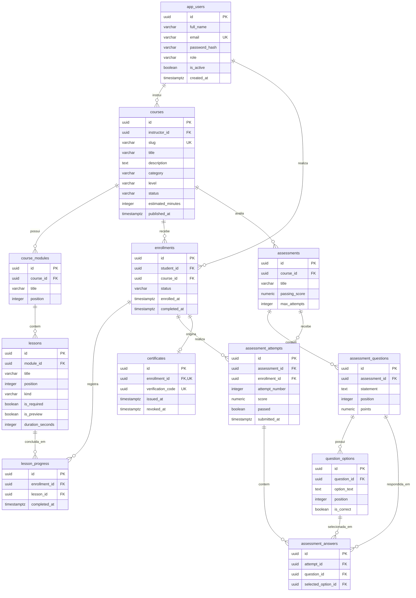

# CursoHub LMS — Modelo Relacional PostgreSQL

> **Versão do esquema:** V1 · **Banco:** PostgreSQL 17 · **Fonte de verdade:** [migração Flyway V1](../backend/src/main/resources/db/migration/V1__create_learning_platform.sql).
>
> **Importante:** o banco já modela cursos, matrículas, progresso, avaliações e certificados. Na **Etapa 1** da aplicação apenas a leitura do catálogo está implementada e validada. As outras entidades existem na base, mas ainda não dispõem de fluxos de negócio completos.

## 1. Modelo conceitual

O **instrutor** cria cursos; os cursos contêm módulos, que contêm aulas. O **aluno** se matricula em cursos e registra o progresso das aulas. Cada curso pode possuir avaliações, compostas por questões e alternativas. As tentativas registram as respostas do aluno. Uma matrícula concluída e elegível pode gerar um certificado.

**Agregados candidatos do domínio (projeto, não implementação completa):** `Course` (módulos e aulas), `Enrollment` (progresso), `Assessment` (questões), `Attempt` (respostas), `Certificate`. Algumas regras de consistência entre agregados precisarão ser coordenadas por casos de uso.

## 2. Diagrama entidade-relacionamento — esquema PostgreSQL V1

O GitHub renderiza este diagrama diretamente a partir de Mermaid. A cardinalidade mostra o relacionamento permitido por cada **FK** e **UNIQUE**; não representa necessariamente todas as regras adicionais dos casos de uso.



> Legenda: `PK` = chave primária, `FK` = chave estrangeira, `UK` = restrição de unicidade. Em `app_users.email`, a unicidade é implementada por um **índice funcional em `lower(email)`**, não por uma constraint `UNIQUE(email)`.

## 3. Dicionário de dados (modelo lógico)

| Tabela | Chave primária | Relacionamentos principais | Restrições importantes |
|---|---|---|---|
| `app_users` | `id: UUID` | Origem dos instrutores e estudantes | `lower(email)` único; `role` controlado |
| `courses` | `id: UUID` | `instructor_id → app_users.id` | `slug` único; estado enumerado; publicação exige data |
| `course_modules` | `id: UUID` | `course_id → courses.id` | posição única por curso |
| `lessons` | `id: UUID` | `module_id → course_modules.id` | posição única por módulo; `kind` limitado |
| `enrollments` | `id: UUID` | `student_id → app_users.id`, `course_id → courses.id` | par aluno + curso único |
| `lesson_progress` | `id: UUID` | matrícula + aula | conclusão única por matrícula + aula |
| `assessments` | `id: UUID` | `course_id → courses.id` | nota de corte 0–100; tentativas ≥ 1 |
| `assessment_questions` | `id: UUID` | `assessment_id → assessments.id` | posição única por avaliação; pontos > 0 |
| `question_options` | `id: UUID` | `question_id → assessment_questions.id` | no máximo uma opção correta por questão |
| `assessment_attempts` | `id: UUID` | matrícula + avaliação | número da tentativa único por matrícula e avaliação |
| `assessment_answers` | `id: UUID` | tentativa + questão + alternativa | questão única por tentativa |
| `certificates` | `id: UUID` | `enrollment_id → enrollments.id` | no máximo um certificado por matrícula; código verificável único |

### Tipos usados

- **UUID:** identificadores independentes de sequências; `gen_random_uuid()` no PostgreSQL.
- **TIMESTAMPTZ:** datas com semântica de instante, apropriadas para auditoria em diferentes fusos.
- **NUMERIC(5,2):** notas percentuais sem erro de ponto flutuante.
- **VARCHAR / TEXT:** campos de tamanho definido e textos longos, respectivamente.
- **BOOLEAN:** estados binários como aula obrigatória, atividade e alternativa correta.

## 4. Cardinalidades e integridade

| Relação | Cardinalidade | Garantia no banco |
|---|---|---|
| Instrutor → Cursos | 1:N | FK obrigatória `courses.instructor_id` |
| Curso → Módulos → Aulas | 1:N / 1:N | FKs, `ON DELETE CASCADE` |
| Aluno → Matrículas ← Curso | N:N resolvido por `enrollments` | `UNIQUE(student_id, course_id)` |
| Matrícula → Progresso ← Aula | N:N resolvido por `lesson_progress` | `UNIQUE(enrollment_id, lesson_id)` |
| Curso → Avaliações → Questões → Alternativas | 1:N / 1:N / 1:N | FKs com `ON DELETE CASCADE` |
| Matrícula → Tentativas ← Avaliação | N:N via `assessment_attempts` | unicidade de número de tentativa |
| Tentativa → Respostas | 1:N | `UNIQUE(attempt_id, question_id)` |
| Matrícula → Certificado | 1:0..1 | `UNIQUE(enrollment_id)` |

## 5. Índices e acesso aos dados

A migração V1 cria, entre outros:

```sql
CREATE UNIQUE INDEX ux_app_users_email_ci
    ON app_users (lower(email));

CREATE INDEX ix_courses_status_category_level
    ON courses(status, category, level);

CREATE INDEX ix_courses_instructor
    ON courses(instructor_id);

CREATE INDEX ix_enrollments_course
    ON enrollments(course_id);

CREATE UNIQUE INDEX ux_one_correct_option_per_question
    ON question_options(question_id)
    WHERE is_correct;
```

**Observações técnicas:**

- O catálogo consulta `status='PUBLICADO'`, categoria, nível, título e descrição. O índice composto auxilia filtros por estado/categoria/nível, mas não garante acelerar pesquisa com `LIKE '%palavra%'`; para escala maior, avaliar `pg_trgm`/GIN ou full-text search, medindo com `EXPLAIN (ANALYZE, BUFFERS)`.
- Índices `UNIQUE` (como `slug` e matrícula aluno+curso) evitam condições de corrida e materializam regras importantes no banco.
- FKs não criam automaticamente índices nas colunas referenciadoras do PostgreSQL. Adicionar índices apenas quando o padrão de acesso e o plano de consulta justificarem.
- A base usa `ON DELETE RESTRICT` em referências críticas para evitar exclusões acidentais de históricos acadêmicos.

## 6. Exemplos de consultas SQL

### 6.1 Catálogo público de cursos

```sql
SELECT id, slug, title, category, level, estimated_minutes
FROM courses
WHERE status = 'PUBLICADO'
ORDER BY title, id
LIMIT 12 OFFSET 0;
```

### 6.2 Cursos por instrutor

```sql
SELECT u.full_name AS instructor, c.title, c.status
FROM courses c
JOIN app_users u ON u.id = c.instructor_id
ORDER BY u.full_name, c.title;
```

### 6.3 Progresso em aulas obrigatórias

```sql
WITH required_lessons AS (
    SELECT cm.course_id, l.id AS lesson_id
    FROM lessons l
    JOIN course_modules cm ON cm.id = l.module_id
    WHERE l.is_required = TRUE
)
SELECT e.id AS enrollment_id,
       COUNT(rl.lesson_id) AS required_count,
       COUNT(lp.id) AS completed_count,
       CASE WHEN COUNT(rl.lesson_id) = 0 THEN 0
            ELSE ROUND(100.0 * COUNT(lp.id) / COUNT(rl.lesson_id), 2)
       END AS progress_percent
FROM enrollments e
LEFT JOIN required_lessons rl ON rl.course_id = e.course_id
LEFT JOIN lesson_progress lp
       ON lp.enrollment_id = e.id AND lp.lesson_id = rl.lesson_id
GROUP BY e.id;
```

**Nota:** a consulta assume que os casos de uso impedirão registrar conclusões de aulas que não pertençam ao curso da matrícula.

### 6.4 Certificados e rastreabilidade

```sql
SELECT c.verification_code, u.full_name, co.title, c.issued_at, c.revoked_at
FROM certificates c
JOIN enrollments e ON e.id = c.enrollment_id
JOIN app_users u ON u.id = e.student_id
JOIN courses co ON co.id = e.course_id
WHERE c.verification_code = :verification_code;
```

Use parâmetro vinculável para `:verification_code`; não concatene parâmetros de entrada em SQL.

## 7. Lacunas de integridade a resolver nas próximas etapas

A migração V1 assegura FKs e unicidade básica, mas **não** assegura todas as regras entre entidades:

1. `lesson_progress.lesson_id` pode, no nível do banco, apontar para uma aula de outro curso que não o da matrícula.
2. `assessment_attempts.assessment_id` não é limitado por FK composta ao curso da matrícula.
3. `assessment_answers.selected_option_id` não é obrigado pela FK a pertencer à `question_id` da própria resposta.
4. O índice parcial de alternativas corretas garante **no máximo uma** correta; não garante **ao menos uma**.
5. `certificates` não comprova por si só a conclusão das aulas nem aprovação nas avaliações.
6. `enrollments.student_id` não garante no nível SQL que o usuário tem papel `STUDENT`, nem `courses.instructor_id` que tem papel `INSTRUCTOR`.
7. A unicidade por aluno + curso é permanente: uma matrícula cancelada não pode ser duplicada sem definir antes uma política de rematrícula.

**Plano:** validar essas regras nos casos de uso com transações, adicionar testes de integração PostgreSQL e, onde justificável, reforçar invariantes com chaves compostas, restrições ou triggers **via novas migrações Flyway**. Não altere a V1 já aplicada.

## 8. Inspeção local — PostgreSQL no Docker

Dentro de `C:\Projetos\cursohub-lms`:

```powershell
docker compose exec db psql -U cursohub -d cursohub -c "\\dt"
docker compose exec db psql -U cursohub -d cursohub -c "\\d+ courses"
docker compose exec db psql -U cursohub -d cursohub -c "SELECT installed_rank, version, description, success FROM flyway_schema_history ORDER BY installed_rank;"
```

Se alterou o usuário/banco via `.env`, substitua `cursohub` nos comandos.

## 9. Evolução e versionamento

- **Esquema base:** `backend/src/main/resources/db/migration/V1__create_learning_platform.sql`.
- **Dados de demonstração:** `backend/src/main/resources/db/demo/V2__demo_catalog.sql`; execução somente quando `FLYWAY_LOCATIONS` inclui `db/demo`.
- **Mudanças futuras:** novas migrações como `V3__indexes_learning.sql` ou `V4__constraints_assessment.sql`, com nomes que não colidam com versões já utilizadas.
- **Ambientes:** nunca ativar migrações de demonstração em produção.
- **Compatibilidade:** novas colunas/índices devem considerar deploy sem indisponibilidade quando já existirem dados reais.

Esse modelo está documentado a partir do SQL efetivo da Etapa 1; não é um esquema hipotético.
